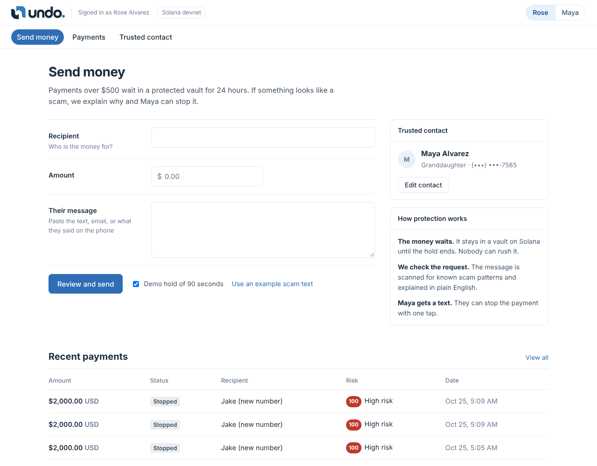
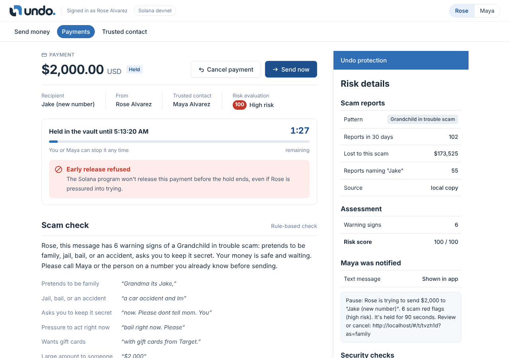
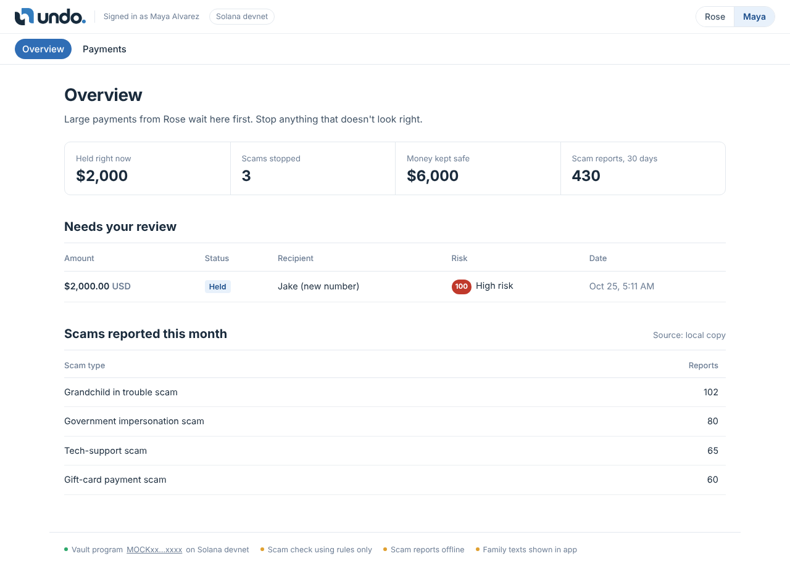

<p align="center"></p>

<p align="center"><b>Scammers rush. Undo makes them wait.</b></p>

<p align="center">A cooling-off vault between seniors and scammers. Large payments sit in a Solana vault before they leave, an AI explains the red flags in plain English, and a trusted family member gets a text and can stop it.</p>

<p align="center">
Built at HackTX 2026 · Solana · Vultr · Snowflake · Twilio
</p>

---

## Why this exists

Americans 60 and older reported **$7.7 billion** in losses to the FBI's Internet Crime Complaint Center in 2025, about 60% more than the year before ([AARP on the FBI report](https://www.aarp.org/money/scams-fraud/fbi-ftc-report-2025-losses.html)). The real number is higher, because a lot of fraud never gets reported.

Almost every one of these scams needs the same two things:

1. **Urgency.** "I'm in jail, I need bail right now." "Your account is compromised, move your money today." The scammer needs you to act before you think or talk to anyone.
2. **Money that can't come back.** Gift cards, crypto, wires. Once it's sent, it's gone.

Undo takes both away. The money waits, and somebody who loves you gets a say before it leaves.

## Screenshots

| Rose sends money | The payment is held, and "Send now" gets refused on-chain | Maya's view |
| --- | --- | --- |
|  |  |  |

## State of the project

| Piece | Status | Where |
| --- | --- | --- |
| Solana vault program (native Rust) | Live on devnet, 14 unit tests passing | `program/src/lib.rs` |
| Program ID | `4N7NXEMn55A6RkZcY2NXJvuATZD2XNPLBgSCkR83JXcY` | [Explorer](https://explorer.solana.com/address/4N7NXEMn55A6RkZcY2NXJvuATZD2XNPLBgSCkR83JXcY?cluster=devnet) |
| Scam-pattern scan with quoted evidence | Working, 11 rules across 7 scam types | `lib/scam.js` |
| AI explanation on Vultr Serverless Inference | Working, with a backup provider and rules-only fallback | `lib/ai.js` |
| Prompt-injection and hidden-character checks | Working | `lib/scam.js`, `lib/ai.js` |
| Snowflake scam intel and outcome logging | Working (900 seeded reports, every decision logged) | `lib/intel.js` |
| Twilio text to the trusted contact | Working (trial account sends a preset template) | `lib/notify.js` |
| On-chain decision receipts, verified in the browser | Working | `server.js`, `public/app.js` |
| Live "try to break it" attacks | Working, real devnet transactions that fail | `lib/chain.js` |
| Hosting | Vultr cloud server, Node 22 under pm2 | `deploy/` |
| Real USD (USDC), bank integrations, logins | Not built. Demo uses devnet SOL at a fixed demo rate | Roadmap below |

## How it works

### The two people

- **Rose** is the senior. She uses Undo the way she'd use her bank's "send money" page.
- **Maya** is her trusted contact (granddaughter here). She gets a text when a big payment is waiting and can stop or approve it. Rose sets who this is on the **Trusted contact** page (name, relationship, phone number).

There are no logins in the demo. The switch in the top right flips between Rose's view and Maya's view.

### What happens when Rose sends money

```
Rose: "Send $2,000 to Jake (new number)"
        + pastes the text that asked for it
                 │
                 ▼
  ┌──────────────────────────── Undo server (Vultr) ────────────────────────────┐
  │ 1. Read the message        strip zero-width / hidden characters               │
  │ 2. Check for AI tricks     "ignore previous instructions", fake verdicts...   │
  │ 3. Scan for scam patterns  11 rules, each with the exact quote it matched     │
  │ 4. Ask Snowflake           how often this script was reported in 30 days      │
  │ 5. Explain it              Vultr AI writes it in plain English for Rose       │
  │ 6. Hold the money          create instruction → Solana vault (PDA)            │
  │ 7. Text Maya               Twilio SMS with a link to review                   │
  └────────────────────────────────────────────────────────────────────────────────┘
                 │
                 ▼
     Money sits in the vault. Only three things can happen:
       • Maya stops it        → money goes back to Rose      (any time)
       • Maya approves it     → money goes to Jake           (any time)
       • The hold ends        → Rose can send it to Jake     (not before)
```

Every step is timed and shown on the payment page under **How it was checked**, so you can watch the pipeline run.

### How long the hold is

| Situation | Hold |
| --- | --- |
| Risk looks low | 1 hour |
| Elevated or high risk | 24 hours |
| Demo mode (checkbox on the send page) | 90 seconds |

### What counts as a red flag

| Rule | Scam type | Example it catches |
| --- | --- | --- |
| Pretends to be family | Grandchild in trouble | "Grandma its Jake" |
| Jail, bail, or an accident | Grandchild in trouble | "I got in a car accident" |
| Asks you to keep it secret | Grandchild in trouble | "please dont tell mom" |
| Pressure to act right now | any | "right now", "today only" |
| Wants gift cards | Gift-card scam | "pay with gift cards from Target" |
| Wants crypto or a Bitcoin ATM | Crypto scam | "send it through a Bitcoin ATM" |
| Wire, cash, or app payment to a stranger | any | "Zelle it to this number" |
| Claims to be the government | Government impersonation | "this is the IRS / Social Security" |
| Fake tech support or bank alert | Tech-support scam | "your computer has a virus" |
| You "won" something | Prize scam | "you won, just pay the fee" |
| Online romance asking for money | Romance scam | "I can't wait to finally meet you, I just need..." |

Each rule has a weight. The scan adds them up into a 0–100 risk score and a level (low, elevated, high). The AI can **raise** the level if it sees something the rules missed. It can never lower it, so a message that talks the AI into calling it safe still gets held as high risk.

## The Solana program

`program/src/lib.rs` is a native Rust program (`solana-program` 2.2). Every payment gets its own vault account, a PDA derived from:

```
seeds = ["deal", senior_pubkey, deal_id (u64, little-endian)]
```

The vault stores the senior, the guardian (family), the payee, the amount, the deadline, and its state.

### Instructions

| # | Instruction | Who can sign | Where the money can go |
| --- | --- | --- | --- |
| 0 | `create` | senior | into the vault, with a release time |
| 1 | `release` | guardian any time; senior **only after the deadline** | **only** the payee stored in the vault |
| 2 | `cancel` | senior or guardian, any time | **only** back to the senior |

That's the whole security model. A scammer on the phone can pressure Rose all they want, but the program won't let the money move early. Even if our server were hacked, the attacker couldn't move the money early or send it anywhere else, because those rules live on Solana, not on the server.

### Errors

| Code | Meaning |
| --- | --- |
| `Custom(2)` | `pause: hold not over`. Senior tried to release before the deadline |
| `MissingRequiredSignature` | the guardian key didn't actually sign |
| `InvalidArgument` | wrong payee / refund destination, or bad instruction data |
| `IncorrectProgramId` | vault isn't owned by this program |
| `InvalidSeeds` | the vault address doesn't match its seeds |
| `InvalidAccountData` | the payment was already settled (no paying out twice) or the account is malformed |
| `InsufficientFunds` | the senior can't cover the amount |

(The on-chain log prefix still says `pause:` because the program was deployed under our old name.)

### Tests

```bash
cd program
cargo test --release
```

14 tests:

| Test | What it proves |
| --- | --- |
| `pack_roundtrip` | vault data encodes and decodes correctly |
| `guardian_can_approve_before_hold_ends` | family can approve early |
| `senior_cannot_be_rushed_before_hold_ends` | the core rule |
| `senior_can_send_after_hold_ends` | it's still her money |
| `scammer_cannot_claim_the_money` | the payee can't pull it out |
| `stranger_cannot_release` | random signers are rejected |
| `guardian_key_must_actually_sign` | passing the key without a signature fails |
| `release_cannot_be_redirected` | money only goes to the stored payee |
| `senior_can_cancel_any_time` | Rose can always change her mind |
| `guardian_can_cancel_any_time` | Maya can always stop it |
| `cancel_cannot_be_redirected` | refunds only go back to Rose |
| `scammer_cannot_cancel_or_redirect` | the payee can't hijack a refund |
| `vault_must_be_owned_by_program` | fake vault accounts are rejected |
| `settled_deal_cannot_pay_twice` | no double payouts |

### Try to break it (live)

When a payment is held, the right panel has a **Security checks** section. Each button sends a real devnet transaction with preflight turned off, so the rejection lands on-chain and you can open it in Solana Explorer.

| Attack | Signed by | Result |
| --- | --- | --- |
| Recipient withdraws the funds | the payee's wallet | rejected: only the guardian, or the senior after the hold, can release |
| Early release under pressure | Rose, before the deadline | rejected: `hold not over` |
| Funds sent to another wallet | release pointed at an attacker wallet | rejected: money can only go to the stored payee |

**Read the vault** reads the account straight from Solana and shows what it's holding and when it unlocks.

### Decision receipts

Every cancel or release includes a memo (Solana Memo program):

```
pause:receipt:<sha256>
```

The hash covers what Undo found (risk level, score, flags, scam type) and who made the call. On the payment page, **Verify on Solana** makes your browser:

1. fetch the receipt data from the server,
2. hash it itself (pure-JS SHA-256, since `crypto.subtle` isn't available on plain HTTP),
3. fetch the transaction directly from the devnet RPC, without going through our server,
4. compare the two.

If they match, the decision on record is exactly what was shown at the time, and nobody edited it later.

## Sponsor tech

### Solana
- Our own Rust program holds the money and enforces the rules (above).
- The server uses `@solana/web3.js` 1.99. Four devnet wallets live in `keys/` (senior, family, payee, attacker) and are created automatically on first run.
- The demo shows dollars and converts to devnet SOL at a fixed demo rate (`DEMO_USD_PER_SOL`, default 10,000).

### Vultr
- The app runs on a Vultr cloud compute instance (Ubuntu, Node 22, pm2, port 80).
- Scam explanations come from **Vultr Serverless Inference**, which is OpenAI-compatible (`https://api.vultrinference.com/v1`). On boot the server lists the available models and picks a working one. You can pin it with `VULTR_MODEL`.
- If Vultr is down, it falls back to a backup OpenAI-compatible provider (`LLM_*`), and then to a rules-only explanation. The status bar at the bottom always says which one is in use.

### Snowflake
- Database `PAUSE.PUBLIC` (created on first run, named before the rename):

```sql
CREATE TABLE SCAM_REPORTS (
  CATEGORY STRING, RECIPIENT STRING, LOSS_USD NUMBER,
  STATE STRING, REPORTED_AT TIMESTAMP_NTZ
);
CREATE TABLE PAUSE_OUTCOMES (
  TRANSFER_ID STRING, CATEGORY STRING, RISK_LEVEL STRING, RISK_SCORE NUMBER,
  AMOUNT_USD NUMBER, OUTCOME STRING, DECIDED_BY STRING, AT TIMESTAMP_NTZ, TX STRING
);
```

- `SCAM_REPORTS` is seeded with 900 **synthetic** reports shaped like the public FTC/IC3 category mix. For each payment we pull reports of that scam type in the last 30 days, total losses, and reports naming the same recipient name.
- Every stop or approval is written to `PAUSE_OUTCOMES`, which feeds the family overview (money kept safe, scams stopped).
- Auth is key-pair JWT. The server generates `keys/snowflake_rsa.p8` and `.pub` on first run, and `/setup` shows the SQL to attach the public key to your user.

### Twilio
- When a payment is held, the trusted contact gets a text with the amount, the risk level, and a review link.
- Twilio trial accounts can only send preset templates, so on a trial account set `TWILIO_TEMPLATE` and Undo sends that template instead. The full alert text is still shown in the app.

## Run it

### Locally, no accounts needed

```bash
npm install
npm run dev        # same as DEADLOCK_MOCK=1 node server.js (macOS/Linux)
# open http://localhost:3000
```

Mock mode fakes the chain, so you can click through the whole flow (hold, refused early send, attacks, cancel, receipt) without a wallet. Everything else is optional. Anything you don't configure falls back gracefully, and the status bar shows what's live.

### For real (devnet)

1. **Deploy the program.** Open `program/src/lib.rs` in [Solana Playground](https://beta.solpg.io), build, and deploy to devnet. Copy the program ID.
2. **Configure.** `cp .env.example .env` and fill in what you have (table below).
3. **Run.**
   ```bash
   npm install
   PROGRAM_ID=<your program id> node server.js
   ```
4. **Fund the demo wallet.** On first run the server prints the senior wallet address. Send it devnet SOL from [faucet.solana.com](https://faucet.solana.com). The server tops up the other demo wallets from it.
5. **Snowflake (optional).** Open `/setup` and run the SQL it shows in a Snowflake worksheet.

### On a Vultr server

```bash
# from your laptop, in the project folder
scp -r server.js lib public deploy package.json package-lock.json root@<server-ip>:/root/pause/
ssh root@<server-ip> "bash /root/pause/deploy/quick.sh <program-id>"
```

`deploy/quick.sh` installs Node 22 if needed, writes `PUBLIC_URL`, opens port 80, and starts the app under pm2. To ship an update later:

```bash
scp -r server.js lib public root@<server-ip>:/root/pause/
ssh root@<server-ip> "pm2 restart pause --update-env"
```

`deploy/smstest.sh` cleans up the `.env` and sends one test text through Twilio.

### Environment variables

| Variable | Needed for | Default | Notes |
| --- | --- | --- | --- |
| `PORT` | server | `3000` | the Vultr box uses 80 |
| `PUBLIC_URL` | links in texts | `http://localhost` | e.g. `http://155.138.232.37` |
| `PROGRAM_ID` | Solana | `program/program-id.txt` if present | your deployed program |
| `SOLANA_RPC` | Solana | `https://api.devnet.solana.com` | |
| `DEMO_USD_PER_SOL` | demo math | `10000` | fake dollars per devnet SOL |
| `DEADLOCK_MOCK` | local testing | off | `1` fakes the chain |
| `VULTR_INFERENCE_KEY` | AI explanation | none | Vultr → Serverless → Inference |
| `VULTR_MODEL` | AI explanation | auto-picked | pin a model id |
| `LLM_API_KEY` | backup AI | none | any OpenAI-compatible API |
| `LLM_BASE_URL` | backup AI | Groq | |
| `LLM_MODEL` | backup AI | `llama-3.3-70b-versatile` | |
| `SNOWFLAKE_ACCOUNT` | Snowflake | none | e.g. `ORG-ACCOUNT` |
| `SNOWFLAKE_USER` | Snowflake | none | your **login name** |
| `SNOWFLAKE_WAREHOUSE` | Snowflake | `COMPUTE_WH` | |
| `SNOWFLAKE_ROLE` | Snowflake | `ACCOUNTADMIN` | |
| `TWILIO_SID` / `TWILIO_TOKEN` | texts | none | |
| `TWILIO_FROM` | texts | none | your Twilio number |
| `TWILIO_TEMPLATE` | texts on a trial account | none | e.g. `sms_appointment_reminders` |
| `FAMILY_PHONE` | texts | none | default trusted-contact number |
| `SENIOR_NAME` / `FAMILY_NAME` | demo people | Rose Alvarez / Maya Alvarez | |

**Never commit `.env` or anything in `keys/`.** Both are in `.gitignore`.

## API

| Method | Path | What it does |
| --- | --- | --- |
| GET | `/api/status` | which services are live, program ID, people, trusted contact (masked) |
| GET | `/api/contact` | the trusted contact |
| POST | `/api/contact` | update it: `{ name, relation, phone }` (phone normalized to E.164) |
| GET | `/api/intel` | family overview numbers + top scam types (Snowflake) |
| GET | `/api/transfers` | all payments, newest first |
| POST | `/api/transfers` | start a payment: `{ payeeName, amountUsd, message, demoHold }` |
| GET | `/api/transfers/:id` | one payment with risk, intel, pipeline, timeline, transactions |
| POST | `/api/transfers/:id/cancel` | stop it: `{ by: "senior" \| "family" }` |
| POST | `/api/transfers/:id/release` | send it: `{ by }` (refused on-chain if Rose tries early) |
| POST | `/api/transfers/:id/attack` | run an attack: `{ kind: "scammer" \| "rush" \| "redirect" }` |
| GET | `/api/transfers/:id/receipt` | receipt data, transaction signature, and RPC URL for browser verification |
| GET | `/api/transfers/:id/vault` | read the vault account from Solana |
| POST | `/api/reset` | clear demo payments |
| GET | `/setup` | setup checklist and Snowflake SQL |

## Layout

```
.
├── server.js            Express app, the protection pipeline, all routes
├── lib/
│   ├── chain.js         Solana: wallets, create/release/cancel, read vault, attacks, mock chain
│   ├── scam.js          sanitize input, scam rules, risk score, category labels
│   ├── ai.js            Vultr / backup LLM, model auto-pick, prompt-injection scan
│   ├── intel.js         Snowflake: key-pair auth, seeding, intel queries, outcome logging
│   └── notify.js        Twilio SMS (custom text or trial template)
├── program/
│   ├── Cargo.toml
│   └── src/lib.rs       the vault program + 14 tests
├── public/
│   ├── index.html       app shell
│   ├── app.js           the whole front end (hash routes, no framework)
│   ├── app.css
│   ├── logo.png
│   ├── setup.html       setup checklist
│   └── pitch.html       pitch page
├── deploy/
│   ├── quick.sh         first-time server setup
│   ├── update.sh        reinstall deps + restart
│   └── smstest.sh       Twilio test text
├── docs/screenshots/
├── SPEC.md              how it's designed and why
├── TESTING.md           how to test every piece, plus the demo run
└── .env.example
```

## Security and privacy notes

- **The message is untrusted data.** It's cleaned of hidden characters, scanned for instructions aimed at the AI, and passed to the model as quoted data, never as instructions.
- **The AI can only make things safer.** It can raise the risk level but never lower it.
- **The money rules live on-chain.** The server can't release early or redirect funds, even if it's compromised.
- **Phone numbers are masked** everywhere except the trusted-contact settings page.
- **This is a devnet demo.** No real money moves. The scam reports in Snowflake are synthetic.

## What's next

- Real dollars with USDC, and an opt-in "safe account" that banks and credit unions can offer seniors
- Family-chosen hold times and limits, more than one trusted contact, and "always allow" for known payees
- Real logins, and a phone-call version for people who don't text
- Feeding stopped scams back into Snowflake so the scam reports come from real outcomes, not seed data

## Team

Nikki Kothapalli, Pallavi Perumalla, Mansi Patel, Jasmitha Madasu
Built in 24 hours at HackTX 2026.

## License

MIT. See [LICENSE](LICENSE).
